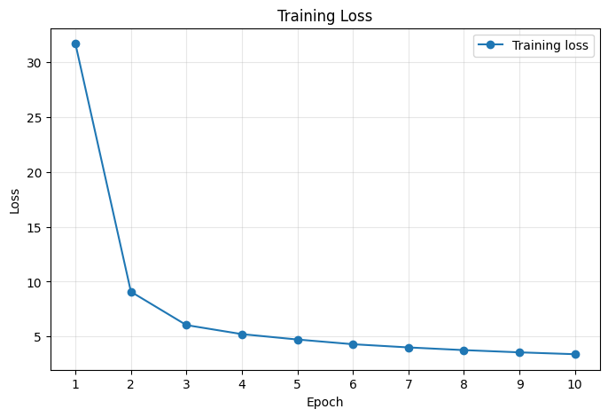
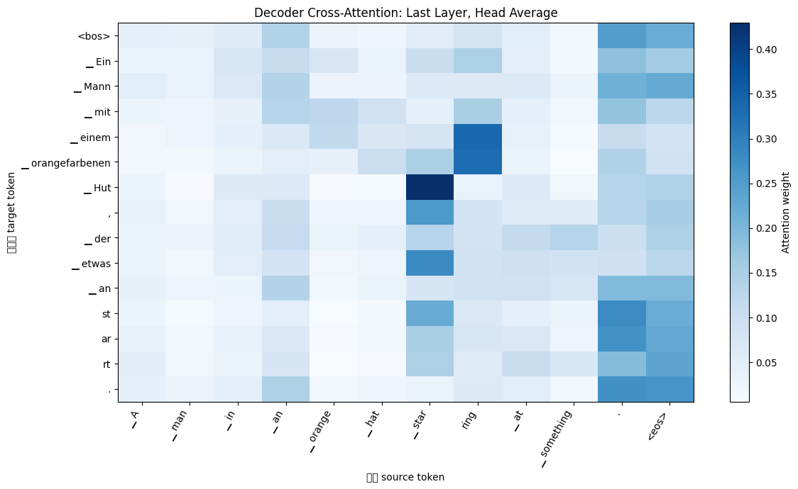

# Attention Is All You Need

## 논문 정보

- 제목: Attention Is All You Need
- 저자: Ashish Vaswani 외
- 링크: [arXiv:1706.03762](https://arxiv.org/abs/1706.03762)

## 구현 상태

모델 구조부터 학습, 번역, BLEU 평가까지 구현했습니다. 로컬에서는 작은 크기의 tensor와 예시 문장으로 각 구성 요소를 확인했고, Colab T4 GPU에서는 Multi30K 영어-독일어 데이터로 실제 학습을 진행했습니다.

## 구현한 구성 요소

- Scaled Dot-Product Attention
- Multi-Head Attention
- Positional Encoding
- Position-wise Feed-Forward Network
- Encoder / Decoder
- Transformer
- BPE tokenizer와 병렬 코퍼스 스트리밍
- 학습 및 검증 루프
- Greedy / Beam Search decoding
- BLEU 평가

## 프로젝트 구조

```text
attention-is-all-you-need/
├── README.md
├── src/                       # 모델, 데이터, 학습 및 추론 코드
├── notebooks/
│   └── train_colab.ipynb      # Colab 학습 및 실험
├── train.py                   # 학습 진입점
├── translate.py               # 문장 번역
├── evaluate.py                # BLEU 평가
└── test.py                    # 로컬 검증
```

## 로컬 테스트

`test.py`에서는 작은 임의 입력을 사용해 다음 항목을 확인합니다.

- 입력과 출력 shape
- forward pass
- backward pass
- gradient 생성 여부

```bash
python test.py
```

## 학습

source와 target 텍스트 파일의 같은 줄이 하나의 번역 쌍을 이루도록 준비합니다. 검증 파일은 생략할 수 있습니다.

```bash
python train.py \
  --train-source data/train.en \
  --train-target data/train.de \
  --validation-source data/valid.en \
  --validation-target data/valid.de
```

tokenizer가 없으면 학습 데이터로 새로 만듭니다. checkpoint는 epoch마다 저장하고, validation loss가 가장 낮은 모델은 `best.pt`에 저장합니다.

## 번역 및 평가

```bash
python translate.py "A man is walking." \
  --checkpoint checkpoints/best.pt \
  --tokenizer-path artifacts/tokenizer.json

python evaluate.py \
  --source data/test.en \
  --target data/test.de \
  --checkpoint checkpoints/best.pt \
  --tokenizer-path artifacts/tokenizer.json
```

`evaluate.py`의 BLEU는 로컬 확인용입니다. 논문 결과와 직접 비교할 때는 논문과 같은 tokenization 및 BLEU 설정을 맞춰야 합니다.

## Colab

`notebooks/train_colab.ipynb`를 Colab에서 열고 위에서부터 실행하면 됩니다. 노트북은 구현 브랜치를 가져온 뒤 Multi30K 영어-독일어 데이터를 내려받고, tokenizer와 checkpoint를 Google Drive에 저장합니다. 학습이 끝나면 예시 문장 번역과 test set 일부의 BLEU 평가까지 이어서 실행합니다.

이번 실험은 Colab T4 GPU 한 장과 제한된 세션 시간 안에서 데이터 준비부터 평가까지 끝내는 것을 목표로 했습니다. 원 논문의 WMT14와 Transformer Base 설정을 T4 한 장으로 학습하면 한 번의 Colab 세션 안에 끝내기 어렵다고 판단했습니다. 그래서 규모가 작고 문장이 짧은 Multi30K를 선택했으며, 모델도 `d_model=256`, Encoder와 Decoder 각각 4 layer로 줄였습니다. 이 설정은 원 논문의 성능을 재현하기 위한 설정이 아니라, 구현한 학습 흐름이 실제 데이터에서 동작하는지 확인하기 위한 설정입니다.

## 실험 결과

Colab T4 GPU에서 Multi30K 영어-독일어 데이터로 10 epoch 학습했습니다.

### 학습 설정

| 항목 | 설정 |
| --- | --- |
| 데이터셋 | Multi30K 영어-독일어 |
| 학습 / 검증 / 테스트 | 29,000 / 1,014 / 1,000 문장 쌍 |
| vocabulary 크기 | 10,000 |
| 최대 문장 길이 | 128 |
| batch size | 64 |
| epoch | 10 |
| `d_model` | 256 |
| attention head | 8 |
| Encoder / Decoder layer | 각각 4 |
| `d_ff` | 1,024 |
| warmup step | 2,000 |

train loss는 첫 epoch의 31.6967에서 마지막 epoch의 3.3796까지 감소했습니다. validation loss도 13.8459에서 3.7868까지 계속 감소했으며, 10번째 epoch의 checkpoint가 `best.pt`로 저장됐습니다.



### BLEU

test set의 앞 100문장을 greedy decoding(`beam_size=1`)으로 번역했을 때 BLEU는 22.85였습니다. 이 값은 프로젝트에 구현한 간단한 BLEU 계산 결과이므로, 원 논문이나 다른 구현의 점수와 비교하려면 tokenization과 평가 조건을 동일하게 맞춰야 합니다.

### 번역 예시

입력:

> A group of people are standing in front of a building.

출력:

> Eine Gruppe von Menschen steht vor einem Gebäude.

테스트 데이터의 앞부분을 번역한 결과는 다음과 같습니다.

| index | 영어 원문 | 독일어 정답 | 모델 번역 |
| --- | --- | --- | --- |
| 0 | A man in an orange hat starring at something. | Ein Mann mit einem orangefarbenen Hut, der etwas anstarrt. | Ein Mann mit einer orangen Kopfbedeckung steht an etwas. |
| 1 | A Boston Terrier is running on lush green grass in front of a white fence. | Ein Boston Terrier läuft über saftig-grünes Gras vor einem weißen Zaun. | Ein Zaun läuft vor einem weißen Zaun auf einer grünen Wiese. |
| 2 | A girl in karate uniform breaking a stick with a front kick. | Ein Mädchen in einem Karateanzug bricht ein Brett mit einem Tritt. | Ein Mädchen in einem Karateanzug läuft vor einem Karate. |
| 3 | Five people wearing winter jackets and helmets stand in the snow, with snowmobiles in the background. | Fünf Leute in Winterjacken und mit Helmen stehen im Schnee mit Schneemobilen im Hintergrund. | Fünf Personen mit Helmen und Jacken stehen im Hintergrund. |
| 4 | People are fixing the roof of a house. | Leute Reparieren das Dach eines Hauses. | Personen befinden sich eines Hauses. |

10 epoch 동안 train loss와 validation loss가 함께 감소했으며, 이 범위에서는 validation loss가 다시 증가하는 모습은 나타나지 않았습니다. 아직 뚜렷한 overfitting은 없다고 볼 수 있습니다.

모자를 쓴 남자와 겨울 장비를 착용한 사람들에 관한 문장은 대상과 문장 구조를 비교적 잘 옮겼습니다. 반면 Boston Terrier 문장에서는 주어를 `Zaun`으로 잘못 번역했고, 지붕을 수리하는 문장에서는 동작을 제대로 표현하지 못했습니다. 기본적인 문장 구조와 단어 대응은 학습했지만, 29,000개의 문장 쌍으로 축소 모델을 10 epoch 학습한 결과라 번역 품질은 아직 일정하지 않습니다.

### Cross-Attention

마지막 Decoder layer의 cross-attention을 모든 head에 대해 평균해 시각화했습니다. 정답 독일어 문장을 Decoder 입력으로 사용한 teacher forcing 결과이므로, 모델이 실제로 생성한 문장을 직접 설명하는 그림은 아닙니다. 또한 여러 head를 평균하면서 각 head가 학습한 attention 패턴이 희석될 수 있으므로, 특정 source token에 attention이 모이는 위치를 확인하는 정도로 보았습니다.



### 실험의 한계

가장 큰 차이는 데이터셋과 모델 크기입니다. Multi30K는 이미지 설명문으로 이루어진 작은 데이터셋이므로, 여기서 얻은 결과만으로 일반적인 영어-독일어 번역 성능을 판단하기는 어렵습니다. 모델 크기와 vocabulary도 원 논문보다 줄였기 때문에 WMT14 결과와 직접 비교할 수 없습니다.

BLEU도 전체 test set이 아니라 앞 100문장만 평가한 값입니다. greedy decoding과 프로젝트 내부의 간단한 tokenization을 사용했으므로, 표준 평가 도구로 측정한 BLEU와 차이가 날 수 있습니다. 번역 예시 역시 다섯 문장뿐이라 모델의 전체적인 오류 경향을 보여주지는 않습니다.

이번에는 seed 42로 한 번만 학습했습니다. 다른 seed에서도 비슷한 loss와 번역 품질이 나오는지, 모델 크기나 학습 시간을 늘렸을 때 얼마나 개선되는지는 확인하지 않았습니다.
