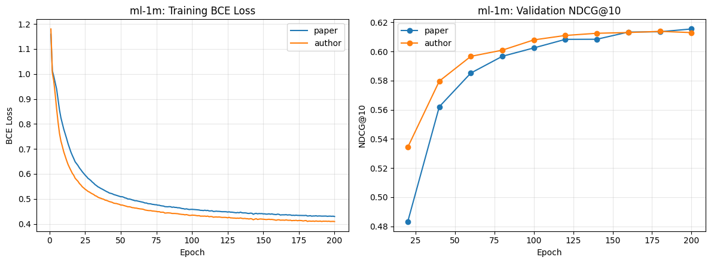
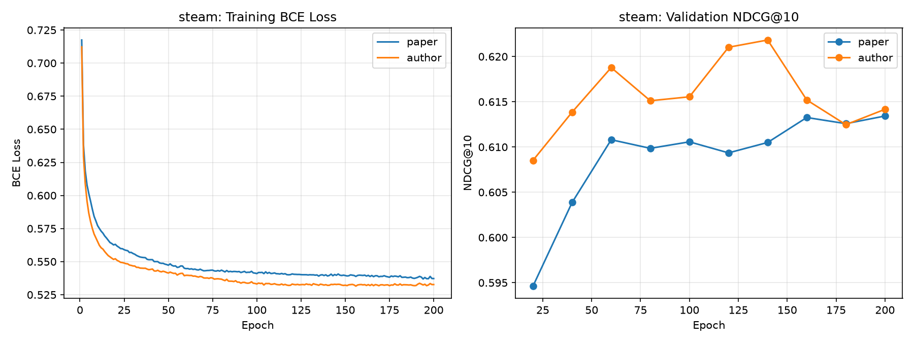
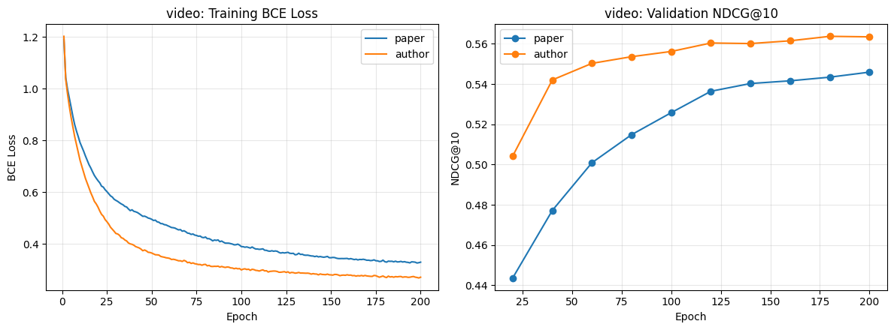
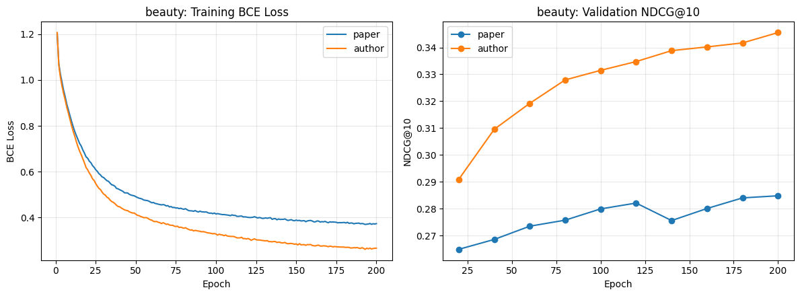

# Self-Attentive Sequential Recommendation

## 논문 정보

- 제목: Self-Attentive Sequential Recommendation
- 저자: Wang-Cheng Kang, Julian McAuley
- 발표: ICDM 2018
- 링크: [arXiv:1808.09781](https://arxiv.org/abs/1808.09781)

## 구현 상태

사용자의 interaction sequence로 다음 item을 예측하는 SASRec의 모델, 데이터 처리, 학습과 평가 파이프라인, Colab 실험 노트북까지 구현했습니다. 논문 수식 기반 블록(`paper`)과 저자 공개 코드(`kang205/SASRec`) 기반 블록(`author`)을 모두 구현해 동일 조건에서 비교했습니다.

`model.py`는 직접 작성했고, `data.py`, `dataset.py`, `metrics.py`, `training.py`는 전부 검토했습니다.

## 구현한 구성 요소

- 저자 전처리 interaction 로딩 및 temporal leave-one-out 분할 (`train` / `valid` / `test`)
- 동적 negative sampling과 고정(`fixed`) 및 가변(`dynamic`) 왼쪽 패딩 `collate_fn`
- Item / learnable positional embedding 및 오른쪽 정렬 위치 인덱싱
- `PaperSASRecBlock`과 `AuthorSASRecBlock` 두 가지 causal self-attention 블록 변형
- 패딩 위치를 제외한 positive/negative BCE loss 및 `l2_emb` 정규화 옵션
- Sampled negative(기본 100개) 및 Full Ranking 기반 `HR@K`, `NDCG@K` 평가
- `tqdm` 배치 진행률 표시, `TensorBoard` 로깅, `best.pt` / `last.pt` / `metrics.json` 저장 및 `--resume` 학습 재개

## 프로젝트 구조

```text
sasrec/
├── README.md
├── assets/
│   ├── ml-1m-comparison.png   # ML-1M 학습 손실 및 검증 NDCG@10 곡선
│   ├── steam-comparison.png   # Steam 학습 손실 및 검증 NDCG@10 곡선
│   ├── video-comparison.png   # Video 학습 손실 및 검증 NDCG@10 곡선
│   └── beauty-comparison.png  # Beauty 학습 손실 및 검증 NDCG@10 곡선
├── src/
│   ├── __init__.py            # 패키지 공개 심볼 정의
│   ├── data.py                # interaction 로딩과 leave-one-out 분할
│   ├── dataset.py             # sequence 구성, negative sampling, 왼쪽 패딩
│   ├── model.py               # Paper/Author SASRec 블록 및 SASRec 모델
│   ├── metrics.py             # 순위 계산, HR@K, NDCG@K
│   └── training.py            # BCE loss, 학습과 평가 루프, 체크포인트 저장과 복원
├── notebooks/
│   └── train_colab.ipynb      # Colab 학습 및 Paper vs Author 비교 실험
├── train.py                   # CLI 학습과 평가 진입점, TensorBoard 기록 및 --resume
└── test.py                    # 로컬 핵심 검증 테스트
```

## 로컬 테스트

`test.py`에서는 작은 합성 입력과 임시 데이터 파일로 마스크 안전성, 모델 계약(초기화, causality, 고정과 가변 길이 일치, 입력 검증), 데이터 분할과 패딩, 평가 지표, 학습과 체크포인트 복원(RNG 상태 재현 포함)을 검증합니다.

```bash
python test.py
```

## 학습

`data/` 아래에 저자 전처리 데이터셋(`ml-1m.txt`, `Video.txt`, `Beauty.txt`, `Steam.txt`)을 두고 실행합니다.

```bash
# 논문 수식 블록 vs 저자 공개 코드 블록 학습 (기본 ML-1M 설정)
python train.py --data-path data/ml-1m.txt --block-variant paper --seed 42
python train.py --data-path data/ml-1m.txt --block-variant author --seed 42

# 희소 데이터셋 예시 (max_len=50, dropout=0.5)
python train.py --data-path data/Beauty.txt --block-variant author --max-len 50 --dropout 0.5

# 전체 미관측 아이템 대상 Full Ranking 평가 시
python train.py --data-path data/ml-1m.txt --block-variant author --eval-negatives all

# 중단된 학습 재개 (output_dir/last.pt 기준)
python train.py --data-path data/Steam.txt --block-variant author --max-len 50 --dropout 0.5 --resume
```

기본 출력 경로는 `outputs/<dataset>/<block-variant>/seed<seed>/`로 분리되며 `best.pt`, `last.pt`, `metrics.json`, `tensorboard/` 이벤트 로그가 저장됩니다. 실시간 곡선은 아래 명령으로 확인할 수 있습니다.

```bash
tensorboard --logdir outputs
```

## Colab

`notebooks/train_colab.ipynb`를 Colab에서 열고 위에서부터 실행하면 선택된 데이터셋(`ml-1m` / `video` / `beauty` / `steam`)을 내려받아 `paper`와 `author` 두 변형을 동일한 시드로 학습하고, `metrics.json` 비교 그래프와 `best.pt` 기반 Full Ranking 교차 평가까지 이어서 실행합니다.

## 실험 설정 (`paper` vs `author` 비교 기준)

두 블록 변형의 차이를 분리해 보기 위해 아래 4가지 구조 차이만 독립 변인으로 두고 나머지 학습 및 평가 조건은 동일하게 통제했습니다.

- 독립 변인 (`--block-variant`, [`SASRec.__init__`](src/model.py#L189-L199))
  - Attention `LayerNorm` 대상: Q, K, V 전체([`PaperSASRecBlock.forward`](src/model.py#L80-L85)) vs Q만([`AuthorSASRecBlock.forward`](src/model.py#L143-L148))
  - Residual 기준 텐서: 정규화 전 입력([`PaperSASRecBlock.forward`](src/model.py#L87-L95)) vs 정규화 후 입력([`AuthorSASRecBlock.forward`](src/model.py#L150-L155))
  - Dropout 위치: Attention과 FFN 출력 후 각 1회([`PaperSASRecBlock.__init__`](src/model.py#L54-L68)) vs Attention weight 내부와 FFN ReLU 및 출력 후([`AuthorSASRecBlock.__init__`](src/model.py#L118-L131))
  - Item embedding 스케일링: 미적용(`paper`) vs `sqrt(hidden_dim)` 곱셈(`author`) ([`SASRec.forward`](src/model.py#L240-L242))
- 공통 통제 변인
  - `hidden_dim=50`, `num_blocks=2`, `num_heads=1`, `LayerNorm eps=1e-8` ([`SASRec.__init__`](src/model.py#L164-L202), [`parse_args`](train.py#L294-L299))
  - 가중치 초기화: `Embedding`, `Linear`, `MultiheadAttention`에 `xavier_uniform_` 및 `bias=0` 적용, `padding_idx=0` 행은 0 유지 ([`SASRec._init_weights`](src/model.py#L208-L223))
  - `epochs=200`, `batch_size=128`, Adam(`lr=1e-3`, `betas=(0.9, 0.98)`), `l2_emb=0.0`, `padding_mode="fixed"`, `eval_interval=20`, `seed=42` ([`create_sasrec_optimizer`](src/training.py#L29-L37), [`parse_args`](train.py#L282-L322))

## 실험 결과

Colab T4 GPU에서 원논문과 동일한 4개 벤치마크(`ML-1M`, `Steam`, `Video`, `Beauty`)를 학습했습니다.

### 데이터셋 특성 및 논문 하이퍼파라미터

| 데이터셋      | 파일명         |   Users |  Items | Interactions | 사용자당 평균 | 아이템당 평균 | 희소도 | `max_len` | `dropout` | 평가 대상 |
| ------------- | -------------- | ------: | -----: | -----------: | ------------: | ------------: | -----: | :---------: | :---------: | :-------: |
| ML-1M         | `ml-1m.txt`  |   6,040 |  3,416 |      999,611 |         165.5 |         292.6 | 95.16% |     200     |     0.2     |   전체   |
| Steam         | `Steam.txt`  | 334,730 | 13,047 |    3,686,172 |          11.0 |         282.5 | 99.92% |     50     |     0.5     | 10,000명 |
| Video (Games) | `Video.txt`  |  31,013 | 23,715 |      287,107 |           9.3 |          12.1 | 99.96% |     50     |     0.5     |   전체   |
| Beauty        | `Beauty.txt` |  52,204 | 57,289 |      394,908 |           7.6 |           6.9 | 99.99% |     50     |     0.5     |   전체   |

### 100-Sampled 테스트 평가 (원논문 Table III 비교)

원논문 평가 방식과 동일하게 정답 1개와 무작위 미관측 negative 100개를 대상으로 `HR@10`과 `NDCG@10`을 측정했습니다.

| 데이터셋      | 모델               | Best Epoch | Valid HR@10 | Valid NDCG@10 | Test HR@10 | Test NDCG@10 |
| ------------- | ------------------ | :--------: | ----------: | ------------: | ---------: | -----------: |
| ML-1M         | 원논문 (Table III) |     -     |           - |             - |     0.8245 |       0.5905 |
| ML-1M         | `paper`          |    200    |      0.8439 |        0.6155 |     0.8175 |       0.5950 |
| ML-1M         | `author`         |    180    |      0.8445 |        0.6138 |     0.8197 |       0.5895 |
| Steam         | 원논문 (Table III) |     -     |           - |             - |     0.8729 |       0.6306 |
| Steam         | `paper`          |    200    |      0.8649 |        0.6134 |     0.8588 |       0.6134 |
| Steam         | `author`         |    140    |      0.8703 |        0.6218 |     0.8722 |       0.6274 |
| Video (Games) | 원논문 (Table III) |     -     |           - |             - |     0.7410 |       0.5360 |
| Video (Games) | `paper`          |    200    |      0.7633 |        0.5459 |     0.7313 |       0.5173 |
| Video (Games) | `author`         |    180    |      0.7687 |        0.5637 |     0.7409 |       0.5375 |
| Beauty        | 원논문 (Table III) |     -     |           - |             - |     0.4854 |       0.3219 |
| Beauty        | `paper`          |    200    |      0.4594 |        0.2848 |     0.4345 |       0.2659 |
| Beauty        | `author`         |    200    |      0.5145 |        0.3455 |     0.4798 |       0.3183 |

### Full Ranking 테스트 교차 평가

무작위 negative 샘플링의 분산을 제거하고 전체 미관측 아이템 기준 순위 품질을 확인하기 위해, 각 실험의 `best.pt`로 Full Ranking(`num_negatives=None`)을 추가로 평가했습니다.

| 데이터셋      | 아이템당 평균 상호작용 | `paper` HR@10 | `author` HR@10 | HR@10 상대 차이 | `paper` NDCG@10 | `author` NDCG@10 | NDCG@10 상대 차이 |
| ------------- | ---------------------: | --------------: | ---------------: | --------------: | ----------------: | -----------------: | ----------------: |
| ML-1M         |                  292.6 |          0.2437 |           0.2444 |           +0.3% |            0.1294 |             0.1280 |             -1.1% |
| Steam         |                  282.5 |          0.1160 |           0.1211 |           +4.4% |            0.0580 |             0.0635 |             +9.5% |
| Video (Games) |                   12.1 |          0.0589 |           0.0702 |          +19.2% |            0.0293 |             0.0346 |            +18.1% |
| Beauty        |                    6.9 |          0.0073 |           0.0184 |         +152.1% |            0.0034 |             0.0091 |           +167.6% |

### 학습 곡선









### 결과 요약

`author` 변형은 4개 벤치마크 모두에서 원논문 Table III의 `HR@10`과 `NDCG@10`을 비슷한 수준으로 재현했습니다. `Video`의 `NDCG@10`(0.5375 vs 0.5360)과 `ML-1M`에서 `paper`의 `NDCG@10`(0.5950 vs 0.5905)은 원논문 수치를 소폭 웃돌았고, `Steam`(0.8722 / 0.6274)과 `Beauty`(0.4798 / 0.3183)도 원논문 보고치에 근접했습니다.

두 블록 변형의 격차는 데이터셋의 아이템 희소도에 따라 뚜렷하게 달라졌습니다.

- 아이템당 상호작용이 많은 `ML-1M`(292.6회)과 `Steam`(282.5회)에서는 `author`가 초반에 빠르게 수렴해 중후반(180 epoch, 140 epoch)에 검증 최고점을 기록한 뒤 후반에 소폭 하락했고, `paper`는 200 epoch까지 과적합 없이 완만하게 상승했습니다. `ML-1M`에서는 100-Sampled와 Full Ranking 모두에서 `HR@10`은 `author`, `NDCG@10`은 `paper`가 근소하게 앞섰습니다.
- 아이템 수가 많고 아이템당 상호작용이 적은 `Video`(12.1회)와 `Beauty`(6.9회)에서는 `author`가 두 평가 방식 모두에서 큰 폭으로 앞섰습니다. 특히 Full Ranking 기준 `author`의 상대 우위는 `ML-1M`(+0.3% / -1.1%), `Steam`(+4.4% / +9.5%), `Video`(+19.2% / +18.1%), `Beauty`(+152.1% / +167.6%) 순으로 커졌습니다.
- `xavier_uniform_` 초기화에서는 `num_items`가 크고 `max_len`이 짧을수록 `position_embedding` 대비 `item_embedding`의 초기 표준편차가 작아집니다(`ML-1M` 3.7배, `Steam` 11.4배, `Video` 15.4배, `Beauty` 24.0배). 아이템당 업데이트 횟수가 충분한 `ML-1M`과 `Steam`에서는 `paper`도 학습이 진행되며 격차를 좁혔지만, 아이템당 업데이트가 드문 `Video`와 `Beauty`에서는 `sqrt(hidden_dim)` 스케일링과 FFN, Attention dropout 배치를 포함한 `author` 구조가 수렴 속도와 일반화 모두에서 유리했습니다.

### 실험의 한계

모든 실험은 `seed=42` 단일 실행으로 진행했습니다. 여러 시드로 반복했을 때의 편차나 `ML-1M`처럼 격차가 작은 구간에서의 통계적 유의성은 확인하지 않았습니다.

하이퍼파라미터 역시 `l2_emb=0.0`, 200 epoch으로 고정했습니다. 데이터셋별로 L2 정규화 강도나 학습 epoch을 별도 튜닝하면 최종 성능과 두 변형 사이의 격차가 달라질 수 있습니다.

`Steam`은 원논문 평가 방식을 따라 검증과 테스트 모두 10,000명(`eval_max_users=10,000`)을 샘플링해 측정했습니다. 또한 Colab 무료 GPU 사용량 제한으로 `Steam`의 `paper`와 `author`를 서로 다른 세션에서 학습한 뒤, 저장된 `best.pt`로 로컬 MPS에서 Full Ranking을 교차 평가했습니다(`author`의 로컬 MPS 결과는 Colab CUDA에서 측정한 `0.1211 / 0.0635`와 소수점 넷째 자리까지 일치했습니다).

마지막으로 `paper`와 `author` 비교는 4가지 구조 차이를 한꺼번에 적용한 비교입니다. `sqrt(hidden_dim)` 스케일링, `LayerNorm` 대상, Residual 기준 텐서, Dropout 위치 각각의 개별 기여도를 분리하는 ablation 실험은 포함하지 않았습니다.
